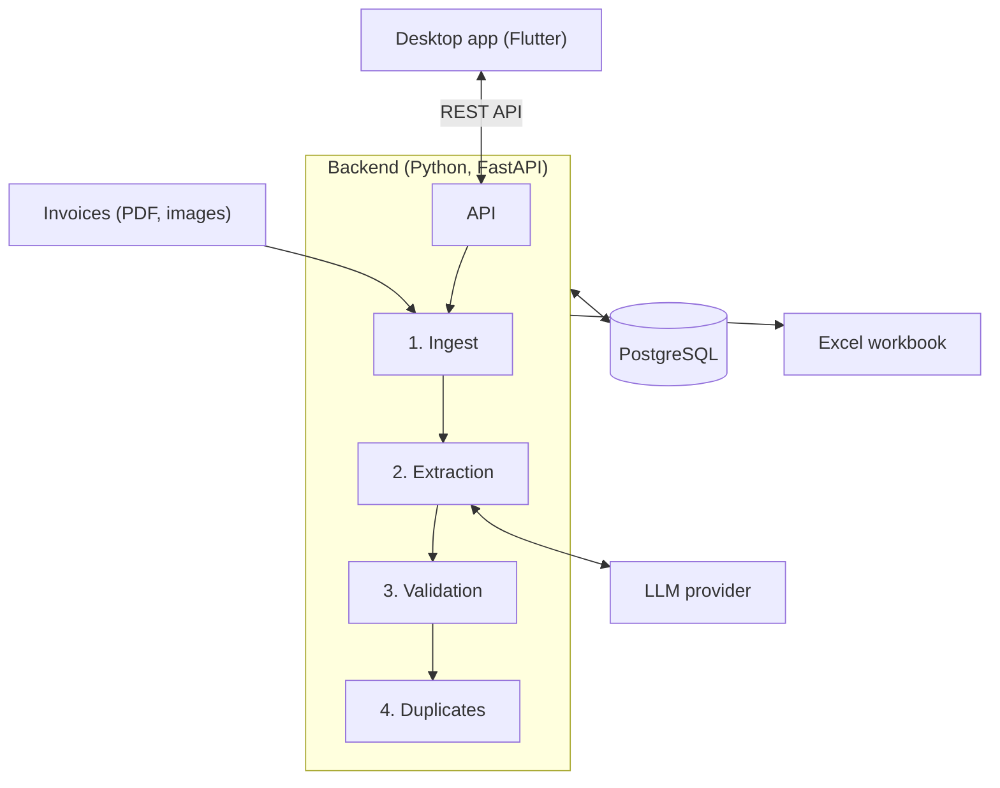

# Architecture

This is the planned design. Each section is updated when its part is built.

## Flow

1. An invoice arrives from an `InvoiceSource`: a folder, a file dropped on the app, or the demo set.
2. The extractor asks an `LLMProvider` for structured output (supplier, date, number, net amount, VAT, total, currency) validated with Pydantic.
3. The validator checks in code that net amount plus VAT equals the total and that the required fields are there.
4. The duplicate check compares supplier and invoice number with what is stored, and the file hash.
5. The result is stored in PostgreSQL with a status: `ok`, `needs_review` or `duplicate`.
6. The reviewer opens the app, sees the document next to its fields, corrects them and approves.
7. The workbook is built from the database on request, one sheet per month with a totals row. Only invoices with status `ok` are written.

## Components

| Part | Folder | Role |
|---|---|---|
| Backend | `backend/` | Python service that owns the logic, the database and the model key. Layers: entry points (`api/`), `services/`, ports and adapters (`providers/source/`, `providers/llm/`, `db/`) and cross-cutting code (`domain/`, `core/`). Each layer depends only on the one below it |
| Desktop app | `desktop/` | Flutter app. It only talks to the REST API: it holds no business logic, no database access and no keys |
| Demo data | `demo/` | Fictitious invoices, generated with dates relative to today so the demo never looks stale |

## Domain model

Built. `backend/app/domain/models.py` holds the Pydantic models every layer shares.

| Model | Role |
|---|---|
| `Extraction` | The fields the LLM returns for one invoice: supplier, invoice number, issue date, net amount, VAT rate, VAT amount, total, currency and a confidence from 0 to 1. Amounts are `Decimal` with two decimals, never floats. Anything that does not fit (a negative total, a currency that is not a three-letter code, a date that is not a date) is rejected |
| `Invoice` | A stored invoice: the extracted fields plus the file name, the SHA-256 of the file, the status, the reasons for review and whether a human approved it |
| `InvoiceStatus` | `ok`, `needs_review` or `duplicate` |

`Extraction.amounts_add_up()` checks that net amount plus VAT equals the total, with one cent of tolerance for rounding.

## Data model

Built. PostgreSQL holds one table, `invoices`. A duplicate is stored too, with its own status, so the reviewer can see it.

| Column | Type | Notes |
|---|---|---|
| `id` | serial | Primary key |
| `file_name` | varchar(255) | Name of the file as it arrived |
| `file_hash` | varchar(64) | SHA-256 of the file, indexed, to spot the same document twice |
| `supplier`, `invoice_number` | varchar | Indexed together, to find the same number of the same supplier |
| `issue_date` | date | |
| `net_amount`, `vat_amount`, `total` | numeric(12, 2) | Exact decimals |
| `vat_rate` | numeric(5, 2) | Percentage |
| `currency` | varchar(3) | ISO 4217 code |
| `confidence` | float | From 0 to 1 |
| `status` | varchar(20) | `ok`, `needs_review` or `duplicate`, indexed |
| `review_reasons` | json | Why it needs review, as a list of sentences |
| `approved` | boolean | True once a human approved it |
| `created_at` | timestamptz | Set by the database |

## Persistence

Built.

- `app/db/models.py`: the SQLAlchemy 2 table class `InvoiceRecord`.
- `app/db/session.py`: one shared engine and session factory. `get_session()` yields a session and closes it afterwards.
- `app/db/repositories.py`: `InvoiceRepository` (`add`, `get`, `list_all`, `has_file`, `find_by_hash`, `find_same_number`, `update`, `delete_all`). It takes and returns domain models, so services never touch tables or SQL. It never commits: the calling service decides when to commit or roll back.
- `migrations/`: Alembic migrations, written by hand. Apply them with `uv run alembic upgrade head`, or print the SQL without connecting with `uv run alembic upgrade head --sql`.
- A test applies the migrations to an empty database and compares the result with the models, so a column added to one and not to the other fails the build.

## Settings

Built. `backend/app/core/config.py` reads typed settings from environment variables and the `.env` file at the project root: `DATABASE_URL`, `LLM_PROVIDER`, `LLM_MODEL`, `OPENROUTER_API_KEY`, `DEMO_MODE`, `INVOICE_FOLDER` (the folder read on request) and `FILES_DIR` (where documents are kept, `data/files` by default). Secrets are `SecretStr`, so they never show in logs.

## Providers

Built. Where invoices come from and the model that reads them sit behind two small interfaces, so the rest of the app never knows which one is behind them.

| Interface | Operations | Implementations |
|---|---|---|
| `InvoiceSource` | `fetch()` returns the documents on offer, each an `InvoiceFile` (name, bytes and their SHA-256) | `DemoSource` (draws the demo invoices, oldest first), `FolderSource` (reads the PDF, PNG and JPEG files of a folder) and `UploadSource` (the files dropped on the app) |
| `LLMProvider` | `extract(file)` returns a validated `Extraction`, or raises `ExtractionError` | `FakeLLMProvider` (knows what each demo invoice says, no key). The real one, a chat model reached through OpenRouter, is not built yet |

`InvoiceSource` has no operation other than `fetch`, and a test checks it: the agent cannot move, delete, pay or send anything. Every source takes only PDF, PNG and JPEG files of up to 10 MB (`limits.py`). `FolderSource` also skips links and folders, and `UploadSource` keeps only the last part of a file name, so a name cannot carry a path.

`FileStore` (`providers/storage.py`) keeps a copy of each document in `FILES_DIR`, named by its SHA-256, so the review screen can show it. It refuses any name that is not a hash, so a request cannot read a file outside the folder.

`app/factory.py` is the one place that reads the settings and chooses the model, the file store and the folder source. A choice that cannot be met (the OpenRouter model, not built yet, or an empty `INVOICE_FOLDER`) raises `ConfigurationError`, which the API answers with 503 and a sentence that says what to change.

## Services

Built. `backend/app/services/` holds the logic. Services receive their providers and the database session through the constructor, and they are the ones that commit.

| Module | Role |
|---|---|
| `checks.py` | The checks made in code on what the model read. `review_reasons()` returns why a human should look: net amount plus VAT is not the total, the VAT amount does not match the rate, the confidence is under 0.8 or the date is in the future. `duplicate_reason()` looks for a stored invoice of the same supplier with the same number. `assess()` runs both and gives the status. `doubtful_fields()` names the fields the reviewer should look at (the total when it does not add up, the VAT amount, a future date, the number of a duplicate, or all of them when the confidence is low) |
| `ingest.py` | `IngestService.run()` takes the documents of a source, reads each new one with the model, checks it and stores it, with one commit per document. A file already stored is skipped, so running it twice stores nothing twice. The same bytes under another name are stored as a duplicate without asking the model. A document the model cannot read is reported and not stored |
| `review.py` | `ReviewService`: `save()` stores the corrected fields, and either the human approves them (the invoice becomes `ok`) or the checks run again. `mark_duplicate()` sets an invoice aside |
| `export.py` | `build_workbook()` returns the `.xlsx` file: one sheet per month, newest first, with a totals row per currency. Only invoices with status `ok` are written |
| `metrics.py` | `compute_metrics()` gives the figures of the Overview screen: counts by status, spend of this month and the last one, spend by month and suppliers by spend. Duplicates are left out of the spend |
| `demo.py` | `reload_demo()` empties the database and ingests the demo set again |
| `preview.py` | `render_preview()` draws the first page of a PDF as a PNG, so the desktop app only shows images |

Loaded through these services, the demo set gives 31 invoices that need nothing, 5 to review and 2 duplicates.

## REST API

Built. `app/api/` is a FastAPI app that only translates HTTP to service calls. Run it with `uv run fastapi dev` from `backend/`: it listens on 127.0.0.1 only. The OpenAPI description is at `/openapi.json` and the interactive docs at `/docs`. Invoices come back with `doubtful_fields`, computed on each request, so the app can outline them without knowing the rules.

| Method and path | Does |
|---|---|
| `GET /health` | Status and whether demo mode is on |
| `GET /invoices?status=` | The invoices, newest first, optionally of one status |
| `GET /invoices/{id}` | One invoice |
| `GET /invoices/{id}/document` | The original document, as it arrived |
| `GET /invoices/{id}/preview` | The first page as an image, for the review screen. A PDF is drawn as PNG with PDFium (`pypdfium2`); an image is returned as it is |
| `PUT /invoices/{id}` | Save the reviewer's fields: `{"fields": {...}, "approve": true}` |
| `POST /invoices/{id}/duplicate` | Set an invoice aside as a duplicate |
| `POST /ingest/upload` | Read the files dropped on the app (multipart, field `files`) |
| `POST /ingest/folder` | Read the new invoices of `INVOICE_FOLDER` |
| `POST /ingest/demo` | Replace every invoice with the demo set. Refused with 403 when demo mode is off |
| `GET /metrics` | The figures of the Overview screen |
| `GET /export` | The Excel workbook |

The session, settings, model, file store and clock are FastAPI dependencies (`api/deps.py`), so the tests replace them with an in-memory database, a temporary folder and a fixed date.

## Desktop app

In progress. `desktop/` is a Flutter app, macOS first, that only talks to the REST API (`API_URL`, `http://127.0.0.1:8000` by default).

| Folder | Role |
|---|---|
| `lib/theme/` | The design tokens (`tokens.dart`, the same values as the mockups), text styles in Montserrat and the theme |
| `lib/api/` | `ApiClient`, a small hand-written client over `http`, and the models of the JSON it reads. An error becomes an `ApiException` with the sentence the backend sent, or one that says the backend cannot be reached |
| `lib/app_state.dart` | `AppState`, a `ChangeNotifier` with what every screen shares: health, demo mode, the figures and the invoice list |
| `lib/shell/` | The window: page background, the dark sidebar with the brand, navigation and top suppliers, and the selected screen |
| `lib/screens/` | One file per screen. Built: Overview (figures, spend by month, suppliers of the month and the invoices waiting for review, plus "Load demo" in demo mode) and Invoices (every invoice as a ticket, filters by dates, supplier, currency, status, number, file type and total, sort by date, a cross on the date, supplier and currency pills to clear them, and the selected invoice with why it needs review in the dark panel). Filters only change what is shown, so they run on screen. Review: the invoices waiting for review one at a time (plus the one opened from Invoices), the first page next to its editable fields with the doubtful ones in gold, previous and next, zoom, "Save and approve" and "Mark as duplicate". The backend validates the fields and its message is shown under the buttons. Export comes next |

The macOS app has the network client permission, so it can reach the backend from its sandbox. The window opens at 1336 x 1000 points, the size of the mockups. The layout adapts down to 1180 x 820 (the sidebar has flexible gaps and the suppliers panel shows only the rows that fit); a smaller window keeps that size and shows scroll bars. Widget tests check four window sizes, so a layout overflow fails the build. Montserrat is fetched by `google_fonts` the first time the app runs. Widget tests use a fake backend (`MockClient`) and the test font. `integration_test/` runs in the real macOS app (`flutter test integration_test -d macos`) and types into the search field and the date picker.

On some macOS installs (older Macs running a patched system) AppKit crashed the app the first time a text field got focus, while loading the font panel favourites. The app never shows the font panel, so `MainFlutterWindow.swift` skips that update (`skipFontPanelUpdates`).

## Demo data

Built. `demo/invoices.json` holds 38 fictitious invoices from 8 invented suppliers, spread over the last six months. Instead of a date each one has `days_ago`, so `load_demo_invoices(today)` (`app/demo/catalog.py`) dates them relative to today and the demo never looks stale. `render_invoice()` (`app/demo/render.py`) draws each one as a one-page PDF with fpdf2, and the same invoice always gives the same bytes.

The set includes, on purpose, the cases the demo shows:

- 3 invoices whose printed total does not equal net amount plus VAT.
- 2 scanned invoices (a grey, slightly turned sheet), read with a lower confidence.
- 1 invoice sent twice as two different files (same supplier and number).
- 1 file that is a byte-for-byte copy of another (same hash).

## Design rules

1. An invoice is untrusted input. The model has no tools and its answer is validated before it is stored.
2. Arithmetic is checked in code. The model is never trusted to say that the amounts add up.
3. The database is the source of truth. The workbook is rebuilt from it, so a correction is never lost.
4. The agent only reads invoices and writes the workbook. It never pays, sends or files anything.
5. Dependencies are injected through constructors, and a fake provider is used in tests and in demo mode.
6. Configuration comes only from environment variables.
