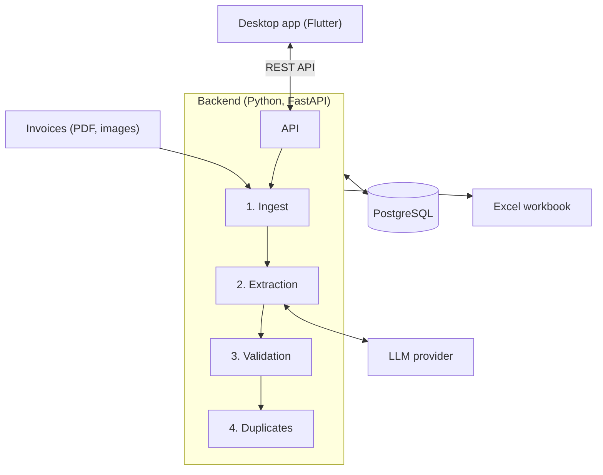

# Architecture

This is the planned design. Each section is updated when its part is built.

## Flow

1. An invoice arrives from an `InvoiceSource`: a folder, a file dropped on the app, or the demo set.
2. The extractor asks an `LLMProvider` for structured output (supplier, date, number, net amount, VAT, total, currency) validated with Pydantic.
3. The validator checks in code that net amount plus VAT equals the total and that the required fields are there.
4. The duplicate check compares supplier and invoice number with what is stored, and the file hash.
5. The result is stored in PostgreSQL with a status: `ok`, `needs_review` or `duplicate`.
6. The reviewer opens the app, sees the document next to its fields, corrects them and approves.
7. The workbook is built from the database on request, one sheet per month with a totals row.

## Components

| Part | Folder | Role |
|---|---|---|
| Backend | `backend/` | Python service that owns the logic, the database and the model key. Layers: entry points (`api/`), `services/`, ports and adapters (`providers/source/`, `providers/llm/`, `db/`) and cross-cutting code (`domain/`, `core/`). Each layer depends only on the one below it |
| Desktop app | `desktop/` | Flutter app. It only talks to the REST API: it holds no business logic, no database access and no keys |
| Demo data | `demo/` | Fictitious invoices, generated with dates relative to today so the demo never looks stale |

## Providers

| Interface | Role | Implementations |
|---|---|---|
| `InvoiceSource` | Where invoices come from | Demo set, folder |
| `LLMProvider` | Turns a document into validated fields | Fake (reads the expected demo data, no key) and a chat model reached through OpenRouter |

A single factory reads the settings and chooses the implementation of each interface.

## Design rules

1. An invoice is untrusted input. The model has no tools and its answer is validated before it is stored.
2. Arithmetic is checked in code. The model is never trusted to say that the amounts add up.
3. The database is the source of truth. The workbook is rebuilt from it, so a correction is never lost.
4. The agent only reads invoices and writes the workbook. It never pays, sends or files anything.
5. Dependencies are injected through constructors, and a fake provider is used in tests and in demo mode.
6. Configuration comes only from environment variables.
